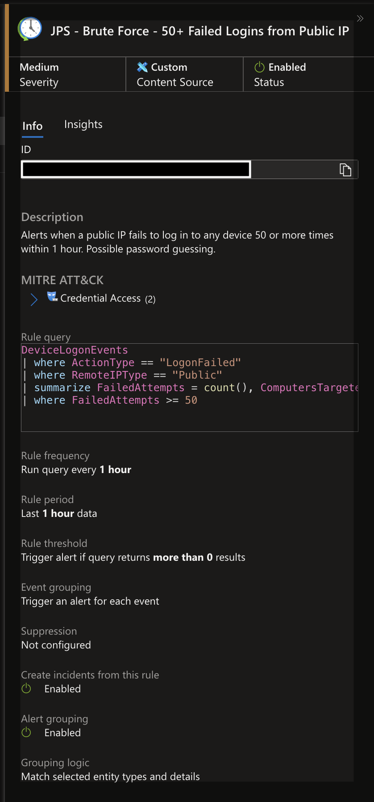
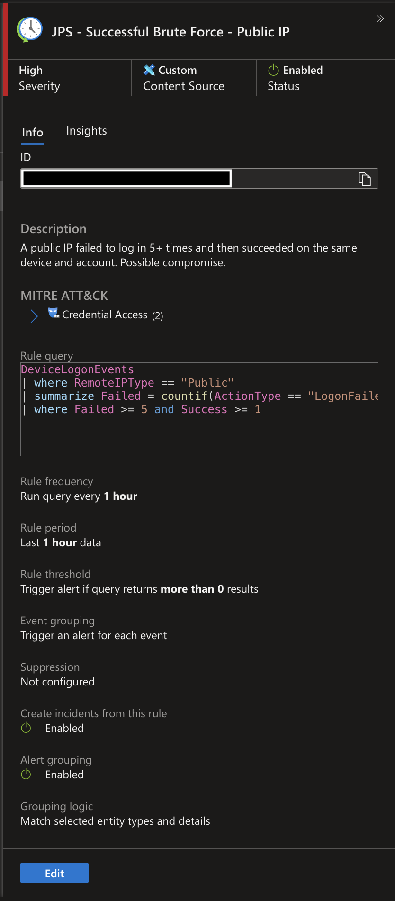
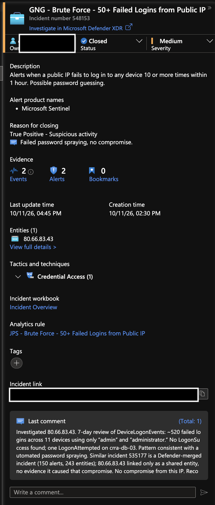
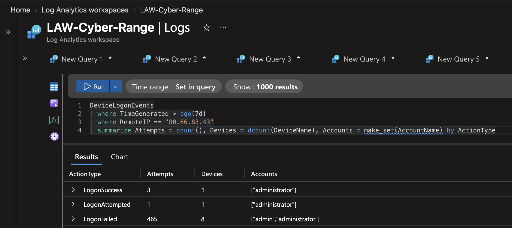
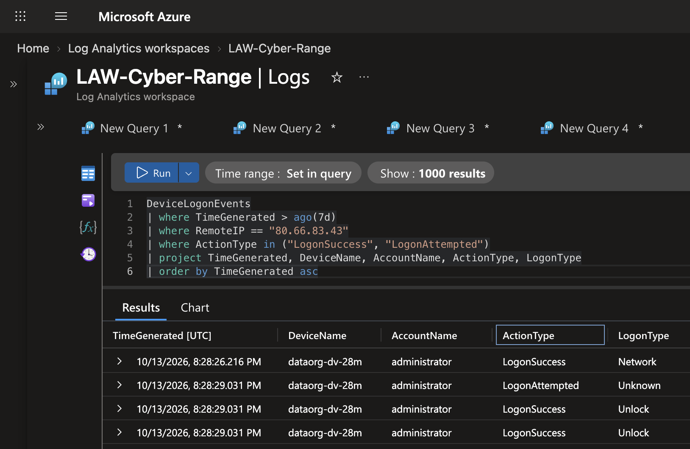
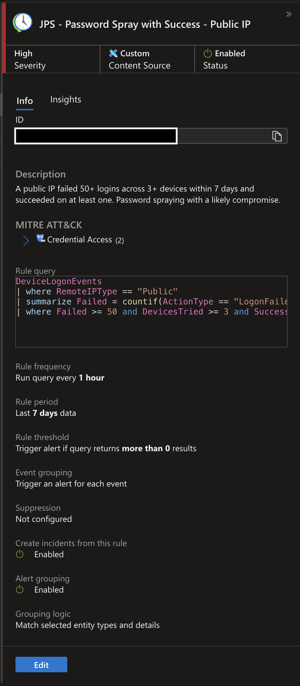

# Detection & Investigation: Password Spraying from a Public IP

**SOC investigation of an internet password-guessing campaign, caught by a Microsoft Sentinel analytics rule I built**: scoped with KQL across 7 days of logon telemetry, confirmed no account was compromised, and classified as a True Positive.

`Microsoft Sentinel` · `Microsoft Defender for Endpoint` · `KQL` · `Detection Engineering` · `MITRE ATT&CK`

---

## What happened

A public IP, **80.66.83.43**, made about **520 failed login attempts across 11 devices** in 7 days, targeting only the generic accounts `admin` and `administrator`. My detection rule raised an incident, and the investigation confirmed **no successful logins**. Two days later, a re-check showed the IP **had succeeded on a new device on the first try**, which my rules missed. I traced the gap to per-device grouping and deployed a new rule to close it.

| Investigation question | Finding | Evidence |
|---|---|---|
| Is this a real attack? | **Yes**: automated password guessing from the internet | ~520 `LogonFailed` events from one public IP |
| How wide was it? | **11 devices** targeted | `dcount(DeviceName)` over 7 days |
| Which accounts? | Only `admin` and `administrator` | `make_set(AccountName)` |
| Did anyone get in? | **No** | 0 `LogonSuccess` events from the IP |
| Is it linked to another compromise? | **No**: a "similar" incident only shared this IP as an entity | Reviewed the related incident's alert sources |
| Did it stay that way? | **No**: 2 days later the IP got in on a new device, and my rule missed it | 3 `LogonSuccess` on `dataorg-dv-28m`, 0 failures on that device |
| How was the gap closed? | New rule grouped by attacker IP across devices | Tested over 1 and 7 days; deployed |

**Verdict:** True Positive. No compromise at first triage; a later compromise found on re-check, which exposed a detection gap that I closed with a new rule. **Recommendation:** block the IP, reset the breached administrator password, keep RDP/SSH off the internet, enforce lockout and MFA.

---

## Skills demonstrated

**Detection engineering** (custom Sentinel analytics rule: thresholds, entity mapping, alert grouping) · **incident triage** · **KQL pivoting** (`summarize`, `dcount`, `make_set`, `countif`) · **scoping across devices and time** · **verifying correlated incidents** rather than assuming · **MITRE ATT&CK mapping** (T1110.003).

---

## 1. Detection: the rule I built

```kql
DeviceLogonEvents
| where ActionType == "LogonFailed"
| where RemoteIPType == "Public"
| summarize FailedAttempts = count(),
            ComputersTargeted = dcount(DeviceName),
            Computers = make_set(DeviceName)
    by RemoteIP
| where FailedAttempts >= 50
```

| Setting | Value | Why |
|---|---|---|
| Severity | Medium | Failed guessing alone is not a breach |
| Frequency | Every hour | Fast enough to catch active campaigns |
| Alert grouping | By IP, 24 hours | One incident per attacker instead of dozens |
| Entities | IP | Lets Sentinel link related incidents |



I also built a companion **High** rule that fires only when failures are **followed by a success** from the same IP (`Failed >= 5 and Success >= 1`), so a guess that works is escalated immediately.



## 2. Triage

Claimed the incident, reviewed severity and entities, and set status to Active.



## 3. Scoping: 7 days of activity from the IP

```kql
DeviceLogonEvents
| where TimeGenerated > ago(7d)
| where RemoteIP == "80.66.83.43"
| summarize Attempts = count(),
            Devices = dcount(DeviceName),
            Accounts = make_set(AccountName)
    by ActionType
```



## 4. Related-incident check

Sentinel listed a "similar" incident on another device. Its alerts came from a different source and the IP appeared only as a shared entity, so I did not link the two. **Similar means a shared entity, not the same attack.**

---

## 5. Follow-up: the attacker came back, and my rule missed it

Two days after I closed the case, I re-ran the scoping query. This time it returned **3 successful logons** for `administrator` from the same IP, on a device I hadn't seen before (`dataorg-dv-28m`, Oct 13, 20:28 UTC). The original verdict was correct at the time (0 successes through Oct 11). This was a **new compromise**.



My companion "successful brute force" rule did **not** fire. Checking the breached device explained why:

```kql
DeviceLogonEvents
| where TimeGenerated > ago(7d)
| where RemoteIP == "80.66.83.43"
| where DeviceName == "dataorg-dv-28m"
| summarize Fails = countif(ActionType == "LogonFailed"),
            Successes = countif(ActionType == "LogonSuccess")
    by AccountName
```

**0 failures, 3 successes.** The attacker got in on the **first try** on that device. That is password spraying working as designed: one password tried once per device across many devices, until it lands. My rule required 5+ failures **on the same device** within 1 hour, so a spray that succeeds first time is invisible to it.

## 6. Closing the detection gap

I re-wrote the logic to group by **attacker IP across all devices**, tested it, and tuned out false positives:

```kql
DeviceLogonEvents
| where RemoteIPType == "Public"
| summarize Failed = countif(ActionType == "LogonFailed"),
            Success = countif(ActionType == "LogonSuccess"),
            DevicesTried = dcount(DeviceName),
            BreachedDevices = make_set_if(DeviceName, ActionType == "LogonSuccess")
    by RemoteIP
| where Failed >= 50 and DevicesTried >= 3 and Success >= 1
```

| Test | Result |
|---|---|
| IP-only grouping, no tuning (7 days) | 16 IPs with failures and a success, across 13 breached devices, including users mistyping their own passwords |
| Tuned: `Failed >= 50` and `DevicesTried >= 3` (7 days) | 8 spraying IPs kept; typo cases dropped |
| Same query over 1 day | Only 2 IPs; **missed 80.66.83.43**, whose attempts were spread over days |

Deployed as a new rule, **JPS - Password Spray with Success - Public IP** (High):

| Setting | Value | Why |
|---|---|---|
| Frequency / lookback | Every 1 hour / 7 days | Catches slow, spread-out spraying |
| Entity | IP | Ties alerts to the attacker |
| Alert grouping | By IP, 7 days | One incident per attacker instead of one per hour |



The original brute-force rules stay in place: they catch a different pattern (many failures on one device).

## MITRE ATT&CK

| Tactic | Technique | Observed |
|---|---|---|
| Credential Access | T1110.003 Password Spraying | Common admin usernames tried across 11 devices |

## Lessons learned

- **Spraying vs. brute force:** many accounts with few tries each slips under lockout thresholds; one account with many tries triggers them.
- **Pair every "failed" rule with a "failed then succeeded" rule.** The second one is what catches the guess that works.
- **Re-check closed cases.** The attacker returned two days later and succeeded on a new device.
- **Group by what the attacker controls.** Per-device thresholds miss spraying; grouping by attacker IP across devices catches it.
- **Test the exact window a rule will use.** A 1-day lookback would have missed the very attack the new rule was built for.

<sub>Cyber-range exercise during my Cybersecurity Analyst internship at LOG(N) Pacific. Live internet traffic against lab VMs; no real victim.</sub>
