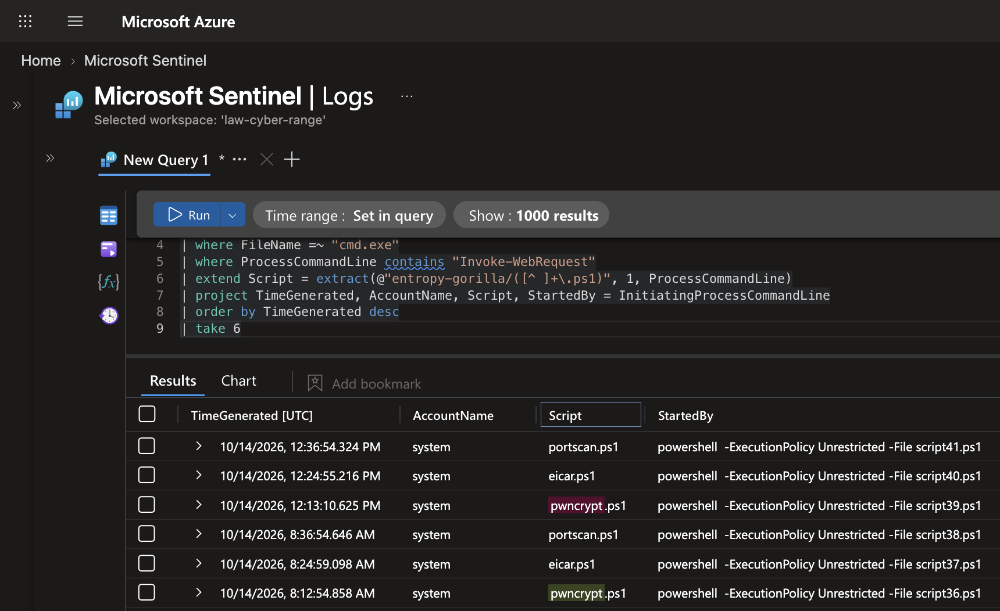
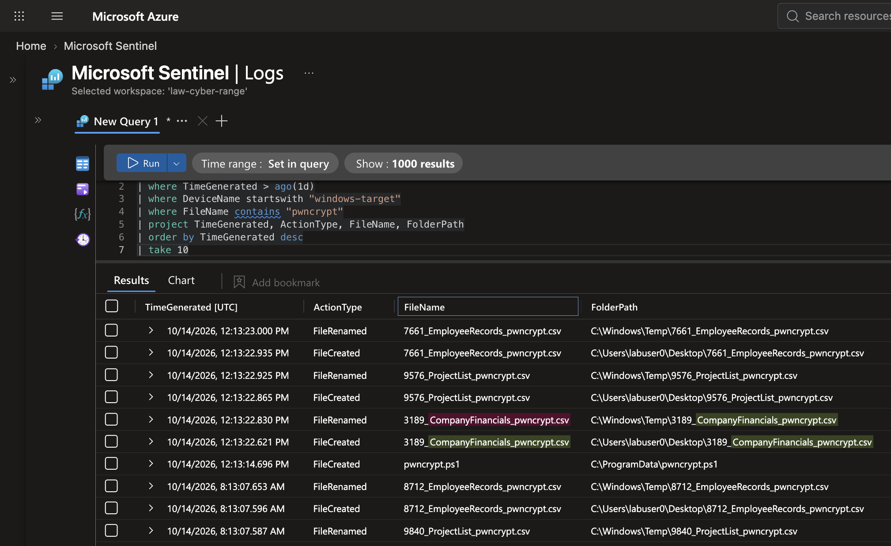
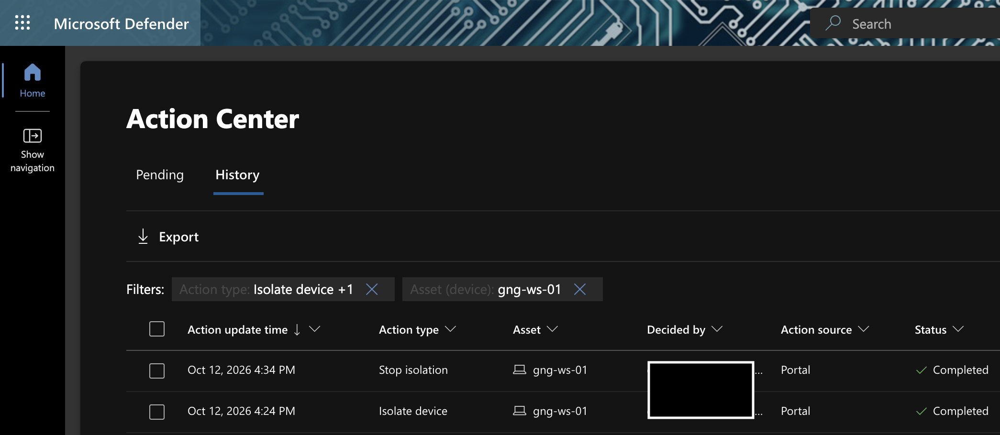

# Investigation & Containment: Ransomware Attack Chain on a Windows Host

**SOC investigation of a PowerShell download alert that unfolded into a full ransomware attack chain**: a scheduled job, tool downloads, and file encryption, traced end to end with Microsoft Defender process and file telemetry, followed by a device-isolation drill.

`Microsoft Sentinel` · `Microsoft Defender for Endpoint` · `KQL` · `Incident Response` · `MITRE ATT&CK`

---

## What happened

A Sentinel alert flagged PowerShell on **windows-target-1** downloading scripts with `-ExecutionPolicy Bypass`. Tracing the process tree showed a **scheduled job running as SYSTEM** that pulls three scripts every 4 hours. One of them, `pwncrypt.ps1`, ran and **encrypted 18 files**. The source was the environment's authorized attack-simulation repository.

| Investigation question | Finding | Evidence |
|---|---|---|
| What started it? | A scheduled job, running as **SYSTEM** | `powershell -File scriptNN.ps1` → `cmd.exe /c` → `powershell Invoke-WebRequest` |
| What was downloaded? | `pwncrypt.ps1`, `eicar.ps1`, `portscan.ps1` to `C:\ProgramData` | DeviceProcessEvents command lines |
| How often? | Every 4 hours, 12 minutes apart (`:12`, `:24`, `:36`) | Timestamps over 3 days |
| Did the ransomware run? | **Yes**: 18 business files encrypted and tagged `_pwncrypt` | DeviceFileEvents |
| Is it a real attacker? | **No**: the environment's authorized simulation | Download source and fixed schedule |

**Verdict:** Benign Positive (authorized simulation). **In production:** critical True Positive, isolate the device immediately. I then practiced that isolation.

---

## Skills demonstrated

**Process-tree analysis** (parent → child chains) · **multi-table correlation** (DeviceProcessEvents + DeviceFileEvents) · **attack-chain reconstruction** · **MITRE ATT&CK mapping** (T1053, T1059.001, T1105, T1486) · **containment** with Defender device isolation · **context-aware verdicts** (simulation vs. production).

---

## 1. Tracing the downloads

```kql
DeviceProcessEvents
| where TimeGenerated > ago(1d)
| where DeviceName startswith "windows-target"
| where FileName =~ "cmd.exe"
| where ProcessCommandLine contains "Invoke-WebRequest"
| extend Script = extract(@"entropy-gorilla/([^ ]+\.ps1)", 1, ProcessCommandLine)
| project TimeGenerated, AccountName, Script,
          StartedBy = InitiatingProcessCommandLine
| order by TimeGenerated desc
| take 6
```

One row per download, with the script name pulled out of the long command line. The six most recent rows show two 4-hour cycles: `pwncrypt.ps1` at :12, `eicar.ps1` at :24, `portscan.ps1` at :36, each started by a numbered `scriptNN.ps1` running as SYSTEM.



## 2. Confirming encryption (1 day)

```kql
DeviceFileEvents
| where TimeGenerated > ago(1d)
| where DeviceName startswith "windows-target"
| where FileName contains "pwncrypt"
| project TimeGenerated, ActionType, FileName, FolderPath
| order by TimeGenerated desc
| take 10
```

The timeline is clear: `pwncrypt.ps1` lands in `C:\ProgramData` at 12:13:14, and **8 seconds later** tagged copies of business files appear on the user's Desktop and are renamed into `C:\Windows\Temp`. The same sequence repeats every 4 hours.

18 files (CompanyFinancials, EmployeeRecords, ProjectList) were created on a user's Desktop and renamed with a `_pwncrypt` tag.



## 3. Attack chain

| Step | What happened | MITRE ATT&CK |
|---|---|---|
| 1 | Scheduled job runs a PowerShell script as SYSTEM | T1053 Scheduled Task |
| 2 | PowerShell downloads tools from the internet | T1059.001 PowerShell · T1105 Ingress Tool Transfer |
| 3 | Ransomware script encrypts business files | T1486 Data Encrypted for Impact |

## 4. Containment drill: Defender device isolation

A real version of this case calls for isolating the device at once. I practiced the full cycle on my own workstation VM:

| Step | Action | Verified by |
|---|---|---|
| Baseline | Connected through Azure Bastion | Session worked |
| Contain | Defender → **Isolate device** (full isolation), with comment | Bastion: "target machine is currently unavailable" |
| Record | Action center logged the action | Comment, account and timestamp recorded |
| Release | **Release from isolation**, with comment | Bastion reconnected |

Defender's Action center recorded both actions on Oct 12: **Isolate device** and **Stop isolation**, 10 minutes apart, both issued from the portal and both Completed.



---

## Lessons learned

- **Process chains show *how* something ran,** not just what ran.
- **Fixed schedules mean automation.** Every 4 hours at :12, :24 and :36 is a job, not a person.
- **Context decides the verdict.** The same evidence is benign in a sanctioned simulation and critical in production, so I documented both.

<sub>Cyber-range exercise during my Cybersecurity Analyst internship at LOG(N) Pacific. Authorized attack simulation; no real victim.</sub>
