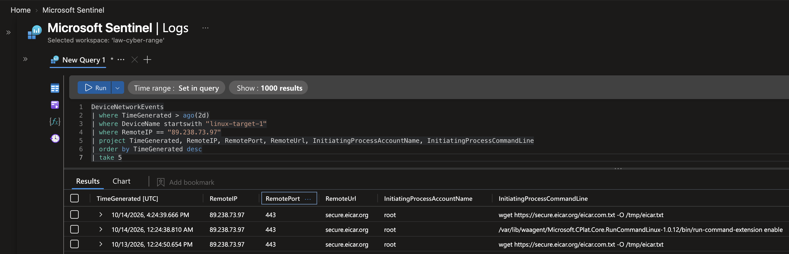
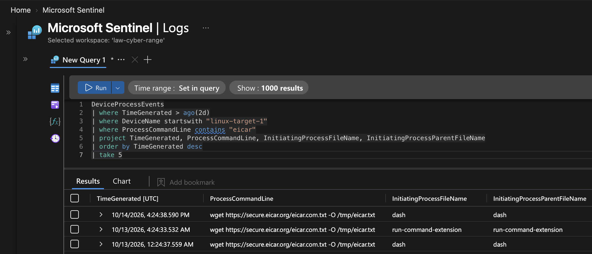

# Investigation: Tool Download on a Linux Server (MITRE T1105)

**SOC investigation of an Ingress Tool Transfer alert on an Ubuntu server**: a search that came up empty, a pivot to network telemetry, parent-process analysis and time correlation that separated a scheduled test from an intrusion.

`Microsoft Sentinel` · `Microsoft Defender for Endpoint` · `KQL` · `Linux` · `MITRE ATT&CK`

---

## What happened

A Sentinel rule fired because `wget` on **linux-target-1** connected to external IP **89.238.73.97**. The download was the harmless **EICAR antivirus test file**, pushed by **Azure Run Command** on a fixed schedule, and nothing was executed afterward.

| Investigation question | Finding | Evidence |
|---|---|---|
| What was downloaded? | The EICAR test file, from `secure.eicar.org` over HTTPS, into `/tmp` | DeviceNetworkEvents: URL, port 443, command line |
| Why didn't the IP appear in the command? | The command used a **domain name**; DNS resolved it to the IP | Empty result in DeviceProcessEvents, match in DeviceNetworkEvents |
| Who started it? | **Azure Run Command** (via the Azure VM agent), not an SSH session | Parent: `run-command-extension` / `dash` |
| Person or automation? | **Automation**: every run at `:24` past the hour across multiple days | Timestamps |
| Was anything executed afterward? | **No**: nothing ran from `/tmp` in 7 days | `FolderPath` hunt |

**Verdict:** Benign Positive, a scheduled antivirus test. The rule worked as designed.

---

## Skills demonstrated

**Pivoting when a search returns nothing** · **network-to-process correlation** (DeviceNetworkEvents + DeviceProcessEvents) · **parent-process analysis** · **time correlation** · **Linux command-line analysis** (`wget`, `/tmp`, shells) · **threat hunting from multiple angles**.

---

## 1. First search: the IP in command lines

```kql
DeviceProcessEvents
| where DeviceName startswith "linux-target-1"
| where ProcessCommandLine contains "89.238.73.97"
```

**No results.** The IP never appeared in the typed command, which pointed to a domain name resolved by DNS.

## 2. Pivot: network events

```kql
DeviceNetworkEvents
| where TimeGenerated > ago(2d)
| where DeviceName startswith "linux-target-1"
| where RemoteIP == "89.238.73.97"
| project TimeGenerated, RemoteIP, RemotePort, RemoteUrl,
          InitiatingProcessAccountName, InitiatingProcessCommandLine
| order by TimeGenerated desc
| take 5
```

Every connection lands at **:24 past the hour**, and one row shows the connection made directly by Azure's `run-command-extension`, an early clue to who was behind it.

| Field | Value |
|---|---|
| RemoteUrl | `secure.eicar.org` |
| Port | 443 (HTTPS) |
| Account | `root` |
| Command | `wget https://secure.eicar.org/eicar.com.txt -O /tmp/eicar.txt` |



## 3. Who started it, and how often?

```kql
DeviceProcessEvents
| where TimeGenerated > ago(2d)
| where DeviceName startswith "linux-target-1"
| where ProcessCommandLine contains "eicar"
| project TimeGenerated, ProcessCommandLine,
          InitiatingProcessFileName, InitiatingProcessParentFileName
| order by TimeGenerated desc
| take 5
```

The parent was `run-command-extension` (Azure Run Command) or the `dash` shell it launches, and every run landed at **:24 past the hour**. An SSH login would show `sshd` → `bash` → `wget` instead.



## 4. Was anything executed from /tmp? (7 days)

```kql
DeviceProcessEvents
| where DeviceName startswith "linux-target"
| where FolderPath startswith "/tmp"
```

**No results.** `eicar.txt` is a text file, and no program ran from `/tmp`.

---

## MITRE ATT&CK

| Tactic | Technique | Observed |
|---|---|---|
| Command and Control | T1105 Ingress Tool Transfer | `wget` download to `/tmp` (authorized test) |

## Lessons learned

- **An empty result is a clue.** The IP lived in network records, not the command line.
- **Parent processes reveal the source.** Azure Run Command and an SSH session look very different.
- **Hunt from several angles.** `FolderPath` catches programs run from `/tmp` however they're started; `ProcessCommandLine` catches scripts passed to a shell (`bash /tmp/x`).

<sub>Cyber-range exercise during my Cybersecurity Analyst internship at LOGN Pacific. Authorized test activity; no real victim.</sub>
