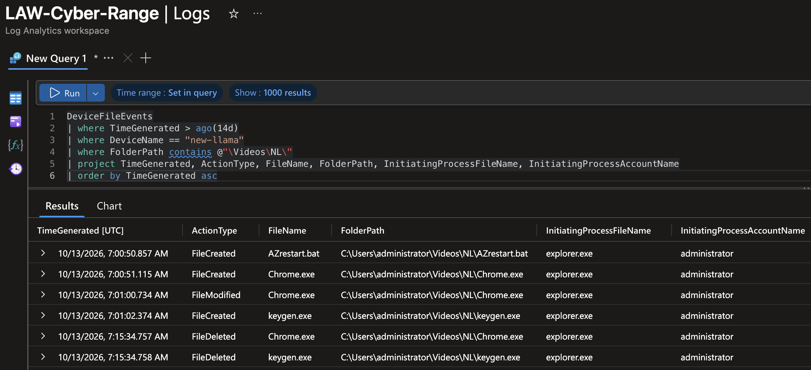
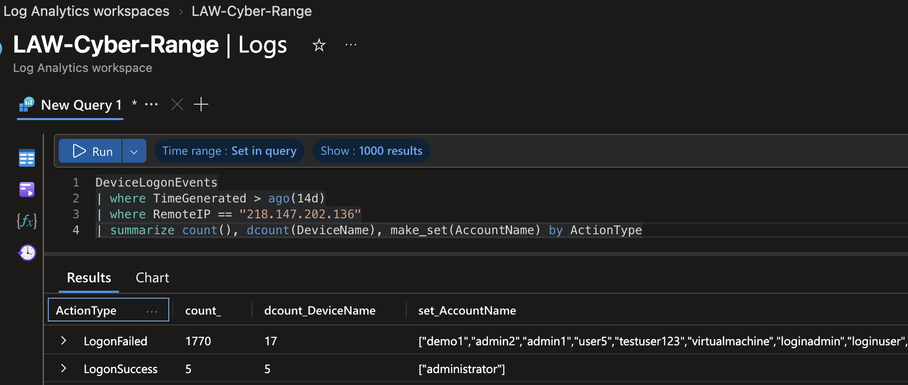
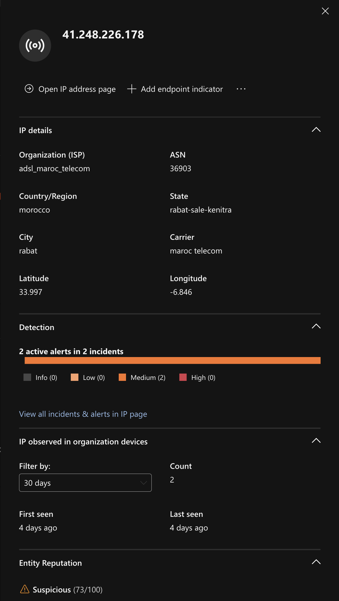
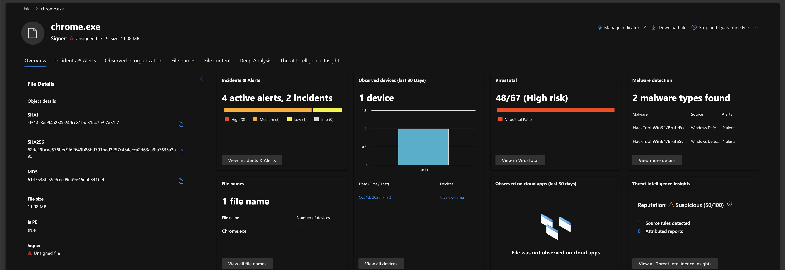

# A Stolen Admin Password, a Disguised Hacking Tool, and a Detection Gap

**SOC investigation from my LOGN Pacific internship.** A detection rule I built flagged a password-guessing attack. I traced it from the first guessed password to attackers using a compromised server to attack others, identified the malware by its fingerprint, and found why antivirus didn't stop it.

`Microsoft Sentinel` · `Microsoft Defender for Endpoint` · `KQL` · `Threat Intelligence` · `Incident Response` · `MITRE ATT&CK`

---

## Key Metrics

| | |
|---|---|
| **Verdict** | True Positive: real attack, real compromise |
| **Failed login attempts** | 1,770 across 17 servers (14 days, as of Oct 20) |
| **Servers where the admin password was guessed** | 5 |
| **Outside attackers who then used that password** | 4 different IP addresses |
| **Attack attempts launched *from* a compromised server** | About 2,000 in under 1 second |
| **Malicious files identified** | 3, verified by file fingerprint (no malware downloaded) |
| **Detected by** | A Sentinel rule I built |

---

## Executive Summary

An attacker on the internet tried hundreds of common usernames and passwords against our servers until the **administrator** password worked on five of them. Shortly after, **other attackers** used that same password to sign in remotely. On one server, they installed a **hacking tool disguised as Google Chrome** and used the server to attack about 2,000 other computers on the internet.

Our antivirus **saw the tools but didn't block them**, because it was set to "report only." I traced every step, identified the tools, and recommended the fixes.

## Business Impact

- **One weak password opened five servers.** The same password was used by at least four different attackers, which suggests it was shared or sold.
- **A compromised server became a weapon.** Attacks launched from your network can get your company's IP addresses blocklisted and damage its reputation.
- **"Detected" is not "stopped."** Security tools only protect you if they're set to act.

## My Role

- **Built the detection rule** that caught the attack
- **Owned the incident** from triage to closure
- **Investigated** across six data sources using KQL (Microsoft's query language)
- **Identified the malware** using Microsoft Defender and VirusTotal, by file fingerprint only
- **Found the detection gap** (antivirus in report-only mode)
- **Documented** findings, **classified** the incident, and **recommended** fixes and escalations

---

## Attack Timeline

| When (UTC) | What happened |
|---|---|
| Oct 6 - 20 | An attacker at **218.147.202.136** tries over 120 usernames against 17 servers (1,770 failed attempts) |
| Oct 13 - 14 | The **administrator** password works on 5 servers |
| Minutes to days later | **4 other IP addresses** sign in to those servers by Remote Desktop with that password |
| Oct 13, 07:00 | On server **new-llama**, the attacker copies in 3 files |
| 07:01 | Antivirus detects 2 of them, but only reports them |
| 07:12 | The attacker runs the tools; the server fires about **2,000 attack attempts** at the internet in under a second (all fail) |
| 07:15 | The attacker **deletes the tools** to cover their tracks |
| Oct 14 | A virus that came with the tools spreads to other programs; a later antivirus scan cleans it |



---

## Investigation

Each step answers one question. Expand **Show the query** to see the exact KQL I ran.

### 1. How big was the attack, and did anyone get in?

**Found:** 1,770 failed attempts on 17 servers using over 120 usernames, plus **5 successful logins**, all as `administrator`. Trying many usernames once each is called **password spraying**.

<details>
<summary>Show the query</summary>

```kql
DeviceLogonEvents
| where TimeGenerated > ago(14d)
| where RemoteIP == "218.147.202.136"
| summarize count(), dcount(DeviceName), make_set(AccountName) by ActionType
```
</details>



### 2. Which servers were breached?

**Found:** 5 servers, with logins in pairs seconds apart, which points to an automated tool. One server had also been breached by a different attacker in my [case 01](01-password-spraying.md), a sign of a weak, widely guessed password.

<details>
<summary>Show the query</summary>

```kql
DeviceLogonEvents
| where TimeGenerated > ago(14d)
| where RemoteIP == "218.147.202.136"
| where ActionType == "LogonSuccess"
| project TimeGenerated, DeviceName, AccountName, LogonType
| order by TimeGenerated asc
```
</details>

### 3. Did anyone actually use the stolen password?

**Found:** Yes. The guessing attacker only **tested** the password. **Four different IPs** came back to sign in with a full desktop, one of them just **2.5 minutes** later. One finds the password, others use it: a pattern called an **initial access broker**.

| Remote Desktop came from | What Microsoft Defender knows about it |
|---|---|
| 105.159.217.168 | Home internet in Morocco |
| 41.248.226.178 | Same provider as above; rated **Suspicious** |
| 89.188.107.27 | Moscow; the session that installed the tools |
| 103.98.148.188 | Hosting company in Vietnam; in 9 other alerts |

<details>
<summary>Show the query</summary>

```kql
DeviceLogonEvents
| where TimeGenerated > ago(14d)
| where DeviceName in ("new-llama", "copr-fin-db01", "corp-ra01-te123", "dataorg-dv-28m", "ncorp1y8ljk9043")
| where ActionType == "LogonSuccess"
| where LogonType == "RemoteInteractive"
| project TimeGenerated, DeviceName, AccountName, RemoteIP
| order by DeviceName asc, TimeGenerated asc
```
</details>



### 4. What did the attacker do on the server?

**Found:** They copied 3 files into an unusual folder (`Videos\NL\`), ran two of them, then deleted those two 15 minutes later. The third, a script, never ran.

<details>
<summary>Show the query</summary>

```kql
DeviceFileEvents
| where TimeGenerated > ago(14d)
| where DeviceName == "new-llama"
| where FolderPath contains @"\Videos\NL\"
| project TimeGenerated, ActionType, FileName, FolderPath, InitiatingProcessFileName, InitiatingProcessAccountName
| order by TimeGenerated asc
```
</details>

### 5. What were the files?

I looked up each file's **fingerprint (SHA256 hash)** in Microsoft Defender and VirusTotal. This identifies malware **without downloading it**.

| File | What it really was | Antivirus engines that flagged it |
|---|---|---|
| `Chrome.exe` | A **brute-force hacking tool** pretending to be Google Chrome. Real Chrome never lives in a Videos folder. | 48 of 67 |
| `keygen.exe` | A cracked license tool for **NLBrute** (a Remote Desktop hacking tool), **infected with the Neshta virus** | 67 of 72 |
| `keygen.exe` (in Temp) | The original NLBrute keygen, unpacked by the virus | 20 of 70 |



### 6. Was the server used to attack others?

**Found:** Yes. 47 seconds after the fake Chrome ran, the server tried to connect to Remote Desktop on about **2,000 internet addresses in under one second**. All attempts failed.

<details>
<summary>Show the query</summary>

```kql
DeviceNetworkEvents
| where TimeGenerated > ago(14d)
| where DeviceName == "new-llama"
| where RemotePort == 3389
| where ActionType in ("ConnectionSuccess", "ConnectionAttempt", "ConnectionFailed")
| summarize count(), dcount(RemoteIP), min(TimeGenerated), max(TimeGenerated) by InitiatingProcessFileName, ActionType
| order by count_ desc
```
</details>

### 7. Why didn't antivirus stop it?

**Found:** Defender detected both tools **11 minutes before they ran**, but it was in **passive mode**: report, don't block. The virus then infected the server's OneDrive startup programs until a scan cleaned it the next day.

<details>
<summary>Show the query</summary>

```kql
DeviceEvents
| where TimeGenerated > ago(14d)
| where DeviceName == "new-llama"
| where ActionType startswith "Antivirus"
| project TimeGenerated, ActionType, FileName, FolderPath, AdditionalFields
| order by TimeGenerated asc
```
</details>

---

## Recommendations

| Fix | Why |
|---|---|
| Reset or disable the administrator account on all 5 servers | Several attackers know the password |
| Rebuild the server that ran the malware | A virus that infects programs can hide in places a cleanup misses |
| Block the 5 attacker IP addresses | Stops these known sources |
| Take Remote Desktop off the open internet (use a VPN or Azure Bastion) and require multi-factor authentication | Stops password guessing at the door |
| Switch antivirus from report-only to blocking mode | Detections must stop threats, not just record them |
| Escalate the other Remote Desktop sessions to Tier 2 | Two servers had sessions that need deeper review |

## MITRE ATT&CK Mapping

| Tactic | Technique | Seen in this case |
|---|---|---|
| Credential Access | T1110.003 Password Spraying | Over 120 usernames across 17 servers |
| Initial Access | T1078 Valid Accounts | The stolen administrator password |
| Lateral Movement | T1021.001 Remote Desktop Protocol | Remote Desktop sessions after the spray |
| Command and Control | T1105 Ingress Tool Transfer | Tools copied onto the server |
| Defense Evasion | T1036.005 Masquerading | Hacking tool named `Chrome.exe` |
| Resource Development | T1584.004 Compromise Infrastructure: Server | Server used to attack others |
| Defense Evasion | T1070.004 File Deletion | Tools deleted after use |

## Lessons Learned

- **Testing a password and using it are different steps.** A "network" login proved the password; a "remote desktop" login showed someone used it, from a different IP.
- **Detected is not stopped.** Always check whether a security tool is set to block or only to report.
- **Check where a program lives, not just its name.** Attackers name tools after trusted software.
- **Use the fingerprint, not the file.** Every malware verdict here came from a hash lookup.
- **Improve my own rule.** It only tagged the attacker's IP, so the incident didn't automatically list the affected servers. Adding server and account tags is my next fix.

---

<details>
<summary><b>Glossary of Terms</b></summary>

| Term | Meaning |
|---|---|
| **Password spraying** | Trying a few common passwords against many usernames, to avoid account lockouts |
| **Remote Desktop (RDP)** | A way to control a Windows computer over the network as if sitting at it |
| **IP address** | A computer's address on the internet |
| **Hash (SHA256)** | A unique fingerprint of a file's contents, used to look files up safely |
| **VirusTotal** | A free service that checks a file against about 70 antivirus engines |
| **KQL** | Kusto Query Language: how analysts search security logs in Microsoft Sentinel and Defender |
| **True Positive** | The alert was correct and the activity was really malicious |
| **MITRE ATT&CK** | A public catalog of attacker techniques that security teams use as a shared language |

</details>

<sub>Cyber-range exercise during my Cybersecurity Analyst internship at LOGN Pacific. Live internet attackers against shared lab VMs; no real victims. Screenshots redacted.</sub>
