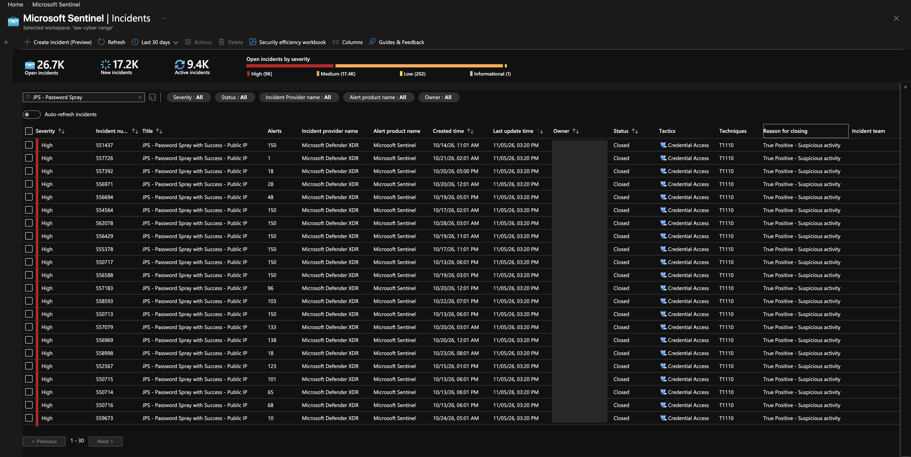
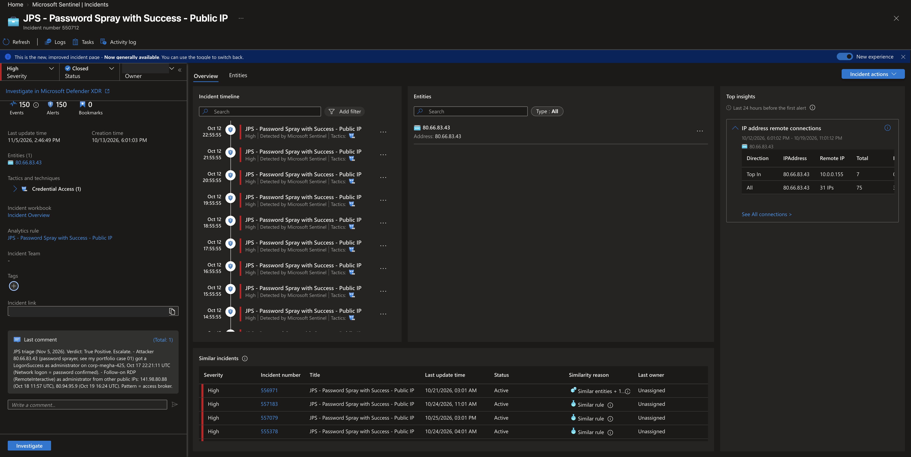
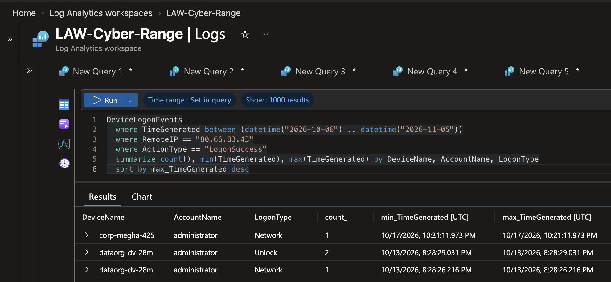
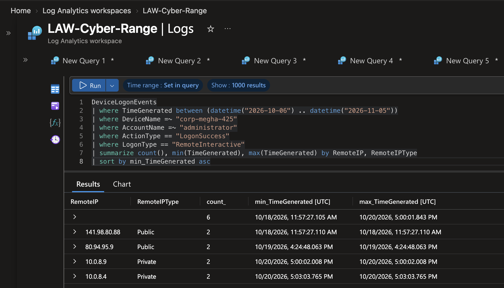
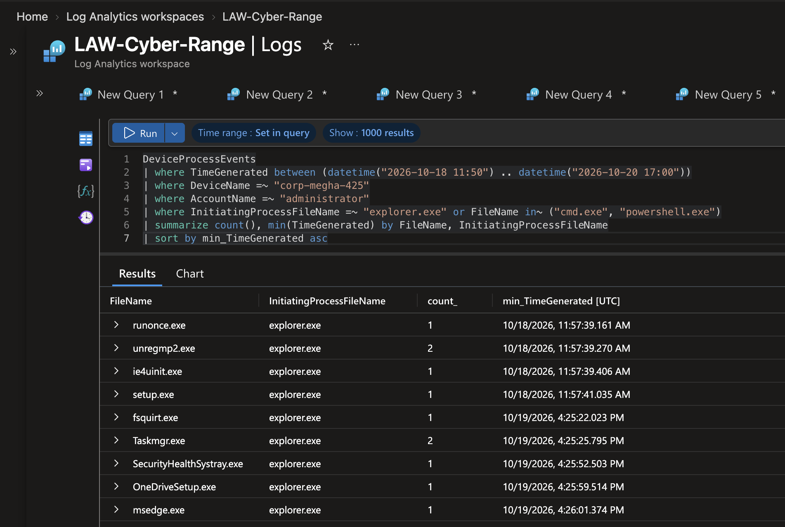
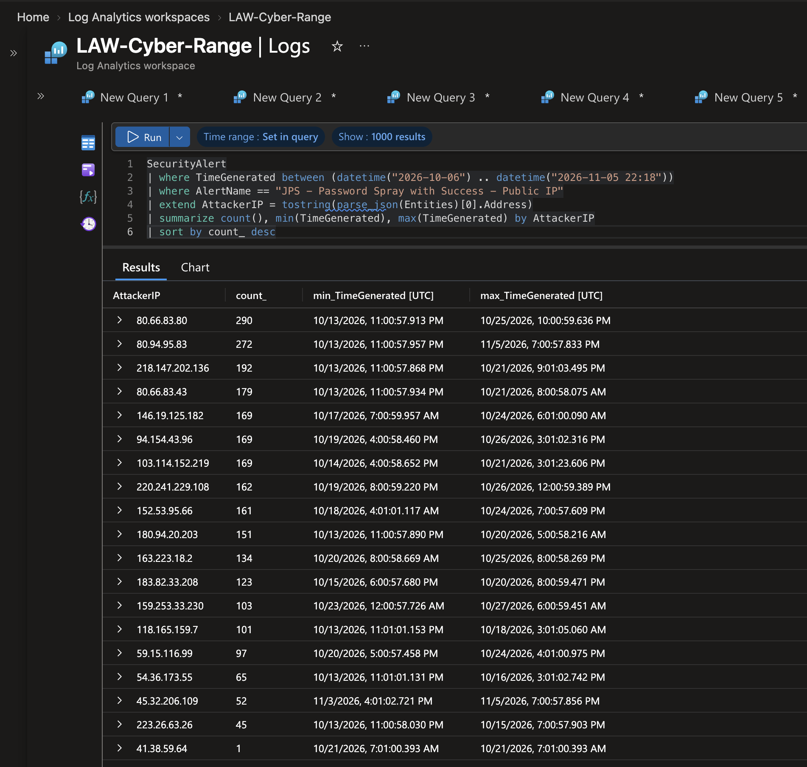
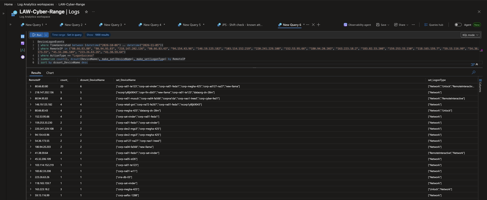
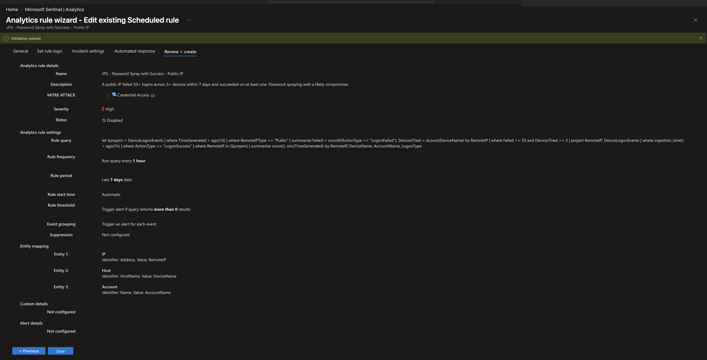
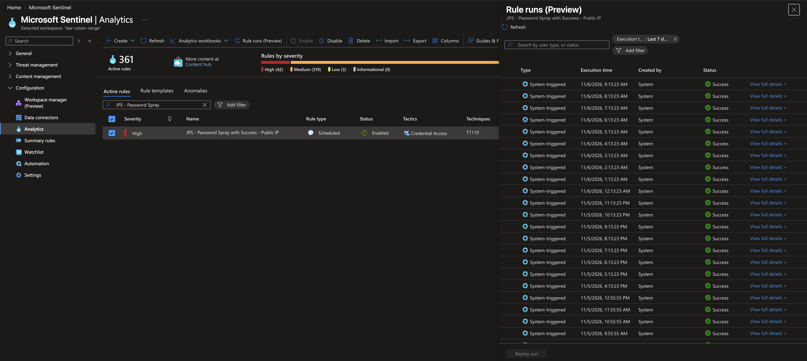

# 30 Incidents, 19 Attackers, 1 Noisy Rule: Triaging a Password-Spray Queue

**Tier 1 triage from my LOG(N) Pacific internship.** My password-spray detection rule had built up a queue of 30 high-severity incidents. I stopped the alert flood, investigated one incident end to end, triaged the rest by attacker instead of one by one, and fixed the rule so one compromise creates one alert.

`Microsoft Sentinel` · `Microsoft Defender for Endpoint` · `KQL` · `Incident Triage` · `Detection Tuning` · `MITRE ATT&CK`

---

## Key Metrics

| | |
|---|---|
| **Verdict** | True Positive: real password spraying, real compromises |
| **Incidents triaged and closed** | 30 (29 in this case, 1 earlier in [case 04](04-password-spray-to-malware.md)) |
| **Attacker IP addresses behind them** | 19, and **every one** got a successful login |
| **Servers with a guessed administrator password** | 21 |
| **Alerts created by the old rule** | 2,635 for 68 successful logins (about 39 alerts per login) |
| **Alerts per successful login after my fix** | 1 |
| **Fix verified** | Checked every hour for 18 hours: all runs clean |

---

## Executive Summary

A detection rule I built had left a queue of 30 open, high-severity incidents, and it was adding more every hour. I **paused the noisy rules**, **investigated one incident fully** (a known attacker had guessed an administrator password, and two other attackers then used it), and **grouped the rest by attacker**: just 19 IP addresses, every one of which had broken into at least one server.

Then I **fixed the rule**. It was re-reporting the same break-in every hour for a week. Now each break-in creates one alert that names the server and the account.

## Business Impact

- **Noise hides real attacks.** One rule turned 68 break-ins into 2,635 alerts. An analyst buried in repeats can miss the one that matters.
- **Weak administrator passwords were shared across the network.** The same servers were broken into by up to five different attackers.
- **Some attackers didn't stop.** Three of the 19 were still trying the day after triage (all attempts failed), which is why I added a "known attackers" check to my start-of-shift routine.

## What Happened, in Order

| When (UTC) | What happened |
|---|---|
| Oct 13 - Nov 5 | 19 internet addresses guess administrator passwords; all 19 get into at least one server (21 servers in total) |
| Oct 17, 22:21 | The attacker from my case 01 gets into a new server, **corp-megha-425** |
| Oct 18 - 19 | Two **other** attackers log in to that server with full remote desktop control |
| Meanwhile | My rule re-reports every break-in once an hour: **2,635 alerts in 30 incidents** |
| Nov 5, afternoon | I pause the noisy rules, investigate one incident fully, then triage the rest by attacker; all 30 closed and escalated |
| Nov 5, evening | I fix the rule (one break-in = one alert) and turn it back on |
| Nov 6 | 18 hourly runs, all clean; the fix is confirmed |

## My Role

- **Owned the queue** of 30 incidents from my own detection rule
- **Contained the noise** by pausing two rules (disabled, not deleted, so their history stays)
- **Investigated** one incident end to end across logins, programs and files with KQL
- **Triaged in bulk** by attacker IP instead of by incident
- **Classified, documented and escalated** every incident with evidence
- **Tuned the detection** and verified it ran cleanly before calling it done

---

## 1. The queue

**Found:** 30 incidents from my rule *JPS - Password Spray with Success - Public IP*. Many held **150 alerts**, the most Sentinel puts in one incident before it opens a new one.

The screenshot shows the end state: all 30 closed as True Positive.



## 2. Deep dive: incident 550712

The incident pointed to **80.66.83.43**, the attacker from my [case 01](01-password-spraying.md). The question was: **did anything new happen since my last check?**



### Did the attacker get in anywhere new?

**Found:** Yes. Besides the server from case 01 (`dataorg-dv-28m`, Oct 13), it logged in as `administrator` on **`corp-megha-425`** on Oct 17. A "Network" login means the password was **tested and accepted**.

<details>
<summary>Show the query</summary>

```kql
DeviceLogonEvents
| where TimeGenerated between (datetime("2026-10-06") .. datetime("2026-11-05"))
| where RemoteIP == "80.66.83.43"
| where ActionType == "LogonSuccess"
| summarize count(), min(TimeGenerated), max(TimeGenerated) by DeviceName, AccountName, LogonType
| sort by max_TimeGenerated desc
```
</details>



### Did anyone use the password?

**Found:** Yes. Two **different** internet addresses opened full Remote Desktop sessions as administrator: **141.98.80.88** (Oct 18, 13.5 hours after the password was guessed) and **80.94.95.9** (Oct 19). One address finds the password, others use it: the same **initial access broker** pattern as case 04.

The Oct 20 sessions came from `10.0.8.x`, the range's Azure Bastion network, most likely the server's owner.

<details>
<summary>Show the query</summary>

```kql
DeviceLogonEvents
| where TimeGenerated between (datetime("2026-10-06") .. datetime("2026-11-05"))
| where DeviceName =~ "corp-megha-425"
| where AccountName =~ "administrator"
| where ActionType == "LogonSuccess"
| where LogonType == "RemoteInteractive"
| summarize count(), min(TimeGenerated), max(TimeGenerated) by RemoteIP, RemoteIPType
| sort by min_TimeGenerated asc
```
</details>



### What did they do?

**Found:** They clicked around the desktop: a first-login setup, **Task Manager** (a common first move to see what the machine has), a Bluetooth file wizard, OneDrive and the Edge browser. **No Command Prompt, no PowerShell**, and no programs or archives were downloaded.

<details>
<summary>Show the query</summary>

```kql
DeviceProcessEvents
| where TimeGenerated between (datetime("2026-10-18 11:50") .. datetime("2026-10-20 17:00"))
| where DeviceName =~ "corp-megha-425"
| where AccountName =~ "administrator"
| where InitiatingProcessFileName =~ "explorer.exe" or FileName in~ ("cmd.exe", "powershell.exe")
| summarize count(), min(TimeGenerated) by FileName, InitiatingProcessFileName
| sort by min_TimeGenerated asc
```

Downloaded files check (programs and archives written as administrator):

```kql
DeviceFileEvents
| where TimeGenerated between (datetime("2026-10-18 11:50") .. datetime("2026-10-20 17:00"))
| where DeviceName =~ "corp-megha-425"
| where InitiatingProcessAccountName =~ "administrator"
| where FileName endswith ".exe" or FileName endswith ".zip" or FileName endswith ".rar" or FileName endswith ".7z"
| project TimeGenerated, InitiatingProcessFileName, ActionType, FolderPath, FileOriginUrl, SHA256
| sort by TimeGenerated asc
```
Result: only an Edge update cleanup and the normal per-user OneDrive install; no download addresses.
</details>



### Verdict

**True Positive.** "No tools found" doesn't make it harmless: an outside attacker had full administrator control of the server for at least two days. I documented the evidence in the incident (screenshot above) and escalated it to the server's owner.

## 3. Bulk triage: by attacker, not by incident

### How many attackers are behind 30 incidents?

**Found:** **19 IP addresses**. Most fired every hour for about a week, which is why the counts run into the hundreds.

<details>
<summary>Show the query</summary>

```kql
SecurityAlert
| where TimeGenerated between (datetime("2026-10-06") .. datetime("2026-11-05 22:18"))
| where AlertName == "JPS - Password Spray with Success - Public IP"
| extend AttackerIP = tostring(parse_json(Entities)[0].Address)
| summarize count(), min(TimeGenerated), max(TimeGenerated) by AttackerIP
| sort by count_ desc
```
</details>



### Where did each one get in?

**Found:** **All 19 had successful logins, on 21 servers in total.** Three of them opened Remote Desktop sessions themselves (80.66.83.80 on 6 servers, 80.94.95.83 on 5, 41.38.59.64 on 2); the rest only tested the password. The case 04 attacker (218.147.202.136) matched exactly the 5 servers from that case. Three servers were broken into by **five different attackers each**: a sign of one weak, widely guessed password.

<details>
<summary>Show the query</summary>

```kql
DeviceLogonEvents
| where TimeGenerated between (datetime("2026-10-06") .. datetime("2026-11-05"))
| where RemoteIP in ("80.66.83.80", "80.94.95.83", "218.147.202.136", "80.66.83.43", "94.154.43.96", "146.19.125.182", "103.114.152.219", "220.241.229.108", "152.53.95.66", "180.94.20.203", "163.223.18.2", "183.82.33.208", "159.253.33.230", "118.165.159.7", "59.15.116.99", "54.36.173.55", "45.32.206.109", "223.26.63.26", "41.38.59.64")
| where ActionType == "LogonSuccess"
| summarize count(), dcount(DeviceName), make_set(DeviceName), make_set(LogonType) by RemoteIP
| sort by dcount_DeviceName desc
```
</details>



I closed the remaining 28 incidents in one action as **True Positive**, with one shared note listing the evidence, the limits, and the recommended fixes.

## 4. Fixing the rule

### Why so many alerts?

The rule ran **every hour** and looked back **7 days**. A single successful login stayed inside that window for 168 hourly runs, so the rule reported it again every hour. One attacker's **1 login became 52 alerts** before I paused the rule.

### The fix

In plain terms: the rule still remembers a week of failed guesses, so it knows who the attackers are, but it now only reports a **new** break-in, once.

- **Kept** the 7-day view to decide *who is a sprayer* (50+ failed logins on 3+ servers). That's what catches slow spraying ([case 01](01-password-spraying.md)).
- **Changed** the break-in check to logins that **arrived in the last hour**, so each one is reported once.
- **Added the server and account** to every alert. [Case 04](04-password-spray-to-malware.md) ended with this as my next fix: the old rule only tagged the attacker's IP, so I had to query for the server every time.

<details>
<summary>Show the rule query</summary>

I used `ingestion_time()` (when the log reached Sentinel) rather than the event time, so a log that arrives late is still checked exactly once.

```kql
let Sprayers = DeviceLogonEvents
| where TimeGenerated > ago(7d)
| where RemoteIPType == "Public"
| summarize Failed = countif(ActionType == "LogonFailed"), DevicesTried = dcount(DeviceName) by RemoteIP
| where Failed >= 50 and DevicesTried >= 3
| project RemoteIP;
DeviceLogonEvents
| where ingestion_time() > ago(1h)
| where ActionType == "LogonSuccess"
| where RemoteIP in (Sprayers)
| summarize count(), min(TimeGenerated) by RemoteIP, DeviceName, AccountName, LogonType
```
</details>

**Tested before saving:** the same logic over 7 days returned exactly the two newest break-ins, one row each.



**Verified after enabling:** 18 hourly runs, all successful. No new break-ins arrived, so no alerts: a real zero, not a broken rule. The 3-hour gap in the run history is the time the rule was paused.



---

## What the evidence can't show

- **Only one server got a full review.** For the other 20, I confirmed the break-ins but didn't review what the attackers did there. The escalation notes say so.
- **The file check covered programs and archives** written by the administrator account, not scripts or files written by the system account.
- **The new server and account tags haven't appeared on a live alert yet,** because no new break-in arrived after the fix. I'll confirm them on the first real alert.

## Recommendations

| Fix | Why |
|---|---|
| Reset the administrator password on all 21 servers, starting with the three hit by five attackers each | Many attackers know these passwords |
| Fully review corp-megha-425 and the servers with Remote Desktop sessions from 80.66.83.80, 80.94.95.83 and 41.38.59.64 | Those attackers had full desktop control |
| Block the 19 attacker IP addresses | Three were still trying the next day |
| Take Remote Desktop off the open internet and require multi-factor authentication | Stops password guessing at the door |
| Review every rule's run frequency against its lookback window | The same overlap creates repeat alerts in any rule |

## MITRE ATT&CK Mapping

| Tactic | Technique | Seen in this case |
|---|---|---|
| Credential Access | T1110.003 Password Spraying | 19 IPs guessing passwords across many servers |
| Initial Access | T1078 Valid Accounts | Guessed administrator passwords on 21 servers |
| Lateral Movement | T1021.001 Remote Desktop Protocol | Remote Desktop sessions as administrator from new IPs |
| Discovery | T1057 Process Discovery | Task Manager opened right after logging in |

## Lessons Learned

- **Stop the flood before you work the queue.** Disabling a rule stops new incidents and keeps its history; deleting it would have removed neither the incidents nor the problem.
- **Group by attacker, not by incident.** 30 incidents were really 19 attackers; one query answered for all of them.
- **"No tools found" is not "benign."** An unauthorized administrator login is the compromise.
- **Match a rule's lookback to its schedule, then verify the fix.** An hourly rule reading 7 days of successes repeats itself up to 168 times; 18 clean runs proved the new version worked.

---

<details>
<summary><b>Glossary of Terms</b></summary>

| Term | Meaning |
|---|---|
| **Triage** | Deciding quickly whether an alert is real, how serious it is, and what happens next |
| **Incident** | A record in Sentinel that groups related alerts for an analyst to work |
| **Analytics rule** | A saved query Sentinel runs on a schedule; matches become alerts |
| **Lookback window** | How far back in time each run of a rule reads |
| **Entity** | An object pulled out of an alert (IP address, server, account) so tools can link alerts together |
| **Network login** | The password was sent over the network and accepted: it proves the password works |
| **Remote Desktop (RDP) login** | A full desktop session: someone actually used the account |
| **Initial access broker** | An attacker who finds working passwords and passes them to others |
| **True Positive** | The alert was correct and the activity was really malicious |
| **KQL** | Kusto Query Language: how analysts search security logs in Microsoft Sentinel and Defender |

</details>

<sub>Cyber-range exercise during my Cybersecurity Analyst internship at LOG(N) Pacific. Live internet attackers against shared range VMs; no real victims. Screenshots redacted.</sub>
